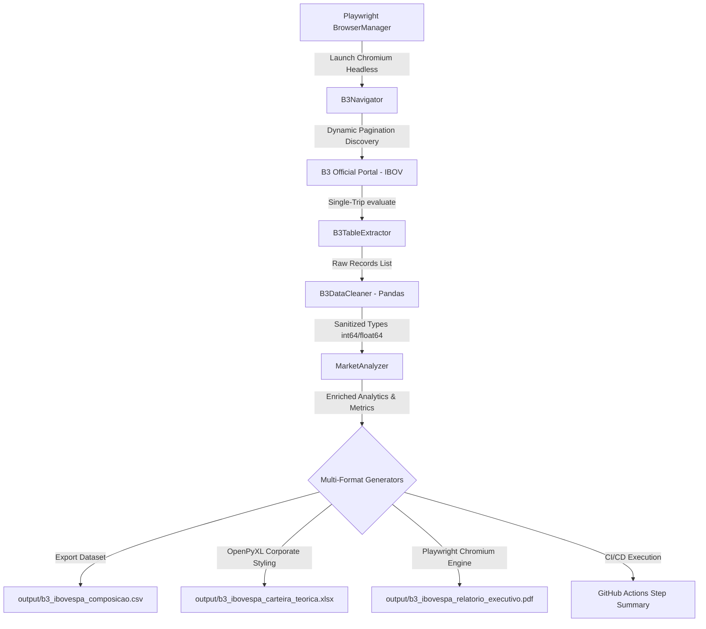

# B3 Ibovespa Theoretical Portfolio RPA Data Extractor (RDEP)

Robô corporativo de automação de processos (RPA) e engenharia de dados desenvolvido em Python, Playwright, Pandas e OpenPyXL. Realiza a extração resiliente da composição da carteira teórica do índice Ibovespa diretamente dos sistemas oficiais da B3, executando higienização financeira, análise de concentração de mercado e geração automatizada de relatórios executivos em múltiplos formatos (CSV, Excel estilizado e PDF executivo de página única).

## Visão Geral da Solução

O robô substitui a coleta manual e propensa a erros de dados de mercado, fornecendo uma esteira end-to-end de inteligência financeira:

1. **Automação Web Headless de Alta Resiliência:** Navegação controlada e manipulação dinâmica de paginação nos sistemas oficiais da B3 (`sistemaswebb3-listados.b3.com.br`) via Playwright.
2. **Extração Tabular em Única Viagem (Single-Trip IPC):** Captura em lote de todas as linhas e colunas através de JavaScript injetado diretamente no DOM do Chromium (`page.evaluate`), reduzindo o tempo de extração para milissegundos.
3. **Higienização e Parsing Numérico Financeiro (pt-BR):** Tratamento rigoroso de convenções brasileiras (conversão de separadores de milhar e decimais para tipos nativos `int64` e `float64`), com tratamento defensivo contra anomalias de rede.
4. **Inteligência de Mercado e Concentração:** Cálculo de curva de participação acumulada (`cumsum()`), ranking de posições, classificação societária de capital (Ordinárias ON, Preferenciais PN e Units UNT) e categorização por faixas de peso (*Mega, Large, Mid e Small Caps*).
5. **Geração de Relatórios Corporativos Multi-Formato:**
   - **Dataset Sanitizado (`.csv`):** Delimitado por ponto e vírgula (`sep=";"`) com codificação `utf-8-sig` para compatibilidade imediata com Excel pt-BR.
   - **Planilha Executiva Estilizada (`.xlsx`):** Desenvolvida com OpenPyXL contendo banner corporativo B3, dashboard de cartões de KPI, formatação contábil nativa (`#,##0` e `0.000%`) e autoajuste dinâmico de largura imune a distorções de células mescladas.
   - **Briefing Executivo de Página Única (`.pdf`):** Relatório visual A4 gerado diretamente pelo motor Chromium do Playwright (`page.pdf`), contendo KPIs, Top 10 maiores ações e tabela de distribuição por classe societária.
6. **Esteira CI/CD em Nuvem (GitHub Actions):** Execução automatizada em contêineres `ubuntu-latest`, publicação de dashboard executivo visual no `$GITHUB_STEP_SUMMARY` e empacotamento dos relatórios na seção *Artifacts*.

## Fluxo Arquitetural



## Destaques de Engenharia e Boas Práticas

### 1. Descoberta Dinâmica de Paginação (`b3_navigator.py`)
Em vez de depender de valores estáticos fixos (*hardcoded*), o robô inspeciona dinamicamente todas as opções do `<select id="selectPage">`, converte para inteiros e seleciona automaticamente o maior valor disponível em tempo de execução (`[20, 40, 60, 120] -> '120'`). A sincronização assíncrona utiliza `wait_for_function` garantindo a renderização completa de todas as linhas antes de avançar.

### 2. Extração Otimizada no DOM (`b3_extractor.py`)
Elimina o gargalo de comunicação entre processos (IPC) que ocorreria ao iterar linha por linha via seletores do Playwright. O método `page.evaluate()` compila a varredura em JavaScript puro executado no contexto do navegador, recuperando toda a matriz de dados em uma única transação de rede.

### 3. Integridade Matemática em Planilhas (`excel_reporter.py`)
Para manter a usabilidade por analistas financeiros e evitar o erro `#VALOR!`, as células numéricas são gravadas como valores puros e recebem máscaras de formato contábil nativas do Excel (`#,##0` para volumes e `0.000%` para percentuais). O algoritmo de cálculo de largura de colunas (*autofit*) foi projetado para avaliar estritamente a partir da linha de cabeçalho (linha 6), prevenindo a distorção clássica causada pelo banner de título mesclado em `A1:I1`.

### 4. Briefing Executivo sem Dependências C++ Externas (`pdf_reporter.py`)
Ao aproveitar a própria instância do Chromium já em execução no Playwright, o robô utiliza `page.pdf` para renderizar HTML5 e CSS Grid/Flexbox diretamente em PDF A4. Isso elimina a necessidade de bibliotecas pesadas como WeasyPrint ou ReportLab, que requerem compiladores C/C++ e dependências de sistema (`cairo`, `pango`, `libffi`) propensas a quebras em ambientes heterogêneos.

### 5. Esteira de Automação CI/CD (`.github/workflows/b3-extractor.yml`)
Configurada para execução em runners `ubuntu-latest`:
- Suporte a disparo manual sob demanda (`workflow_dispatch`) e agendamento via `cron` parametrizado para o pós-fechamento do mercado da B3 (`0 21 * * 1-5` - 18:00 BRT).
- Instalação automatizada das bibliotecas gráficas do Linux via `playwright install chromium --with-deps`.
- Publicação imediata de dashboard com KPIs e Top 10 no **GitHub Actions Job Summary** (`$GITHUB_STEP_SUMMARY`).
- Armazenamento dos 3 relatórios com 30 dias de retenção via `actions/upload-artifact@v4`.

## Entregáveis do Robô (`output/`)

| Arquivo | Formato | Descrição |
|:---|:---:|:---|
| `b3_ibovespa_composicao.csv` | CSV | Base analítica tratada com 76 ativos, codificação `utf-8-sig` e delimitador `;`. |
| `b3_ibovespa_carteira_teorica.xlsx` | Excel | Pasta de trabalho corporativa com KPIs, paleta B3 (`#002060`) e máscaras contábeis. |
| `b3_ibovespa_relatorio_executivo.pdf` | PDF | Briefing executivo de página única A4 com Top 10 ativos e distribuição de capital. |

## Estrutura do Projeto

```text
rpa-data-extractor-python/
├── .github/
│   └── workflows/
│       └── b3-extractor.yml      # Workflow de CI/CD e publicação de artefatos
├── output/
│   └── .gitkeep                  # Diretório de destino dos relatórios gerados
├── src/
│   ├── config/
│   │   ├── __init__.py
│   │   └── browser.py            # Context Manager e factory do Playwright
│   ├── services/
│   │   ├── __init__.py           # Exportação centralizada dos serviços
│   │   ├── b3_navigator.py       # Robô de navegação e manipulação de filtros
│   │   ├── b3_extractor.py       # Extrator tabular via JavaScript evaluate
│   │   ├── data_cleaner.py       # Higienização e parsing de dados pt-BR (Pandas)
│   │   ├── market_analyzer.py    # Engenharia de métricas e concentração
│   │   ├── excel_reporter.py     # Relatório executivo estilizado (OpenPyXL)
│   │   └── pdf_reporter.py       # Briefing executivo em PDF A4 (Playwright)
│   ├── __init__.py
│   └── main.py                   # Ponto de entrada e orquestrador do pipeline
├── .gitignore                    # Proteção de venv, cache e artefatos de saída
├── requirements.txt              # Dependências declarativas do projeto
└── README.md                     # Documentação executiva do repositório
```

## Instruções de Execução Local

### Pré-requisitos
- Python 3.10 ou superior (recomendado: Python 3.11)
- Git

### 1. Clonar o Repositório
```bash
git clone https://github.com/giovanemedeiros/rpa-data-extractor-python.git
cd rpa-data-extractor-python
```

### 2. Criar e Ativar o Ambiente Virtual
No Windows (PowerShell):
```powershell
python -m venv venv
.\venv\Scripts\Activate.ps1
```

No Linux / macOS:
```bash
python3 -m venv venv
source venv/bin/activate
```

### 3. Instalar Dependências e Navegadores
```bash
pip install -r requirements.txt
playwright install chromium
```

### 4. Executar o Robô
```bash
python src/main.py
```

Os relatórios consolidados serão gerados imediatamente no diretório `output/`.

## Governança Ágil e Rastreabilidade no Jira Software

O projeto foi planejado e executado seguindo o padrão corporativo no **Jira Software** (Chave do Projeto: **`RDEP`**):

- **Estrutura de Backlog:** 3 Épicos (`RDEP-1` a `RDEP-3`) decompostos em 8 Histórias de Usuário técnicas (`RDEP-4` a `RDEP-11`).
- **Padrão de Commits:** *Conventional Commits* com rastreabilidade direta aos cards do Jira (ex: `RDEP-10: feat: implement styled openpyxl excel report...`).
- **Qualidade de Código:** Conformidade com PEP 8 e PEP 257 (docstrings em todos os módulos, classes e métodos, e comentários exclusivamente em inglês).

## Licença

Distribuído sob a licença GNU General Public License v3.0 (GPL-3.0). Consulte o arquivo `LICENSE` para mais detalhes.
